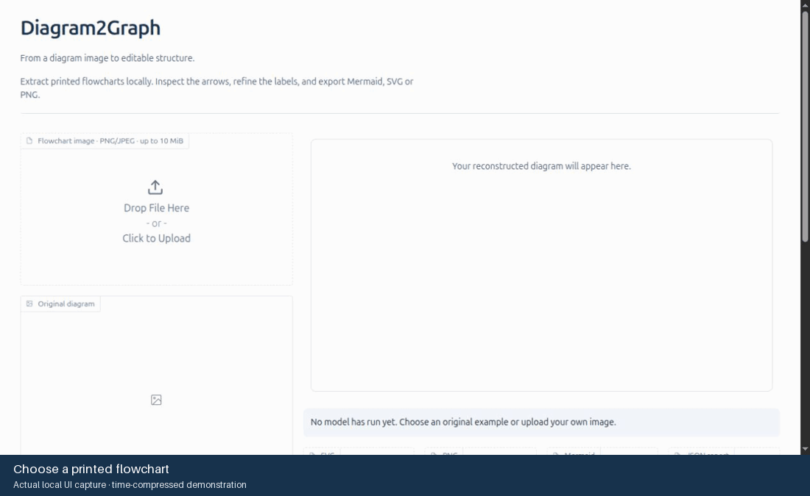
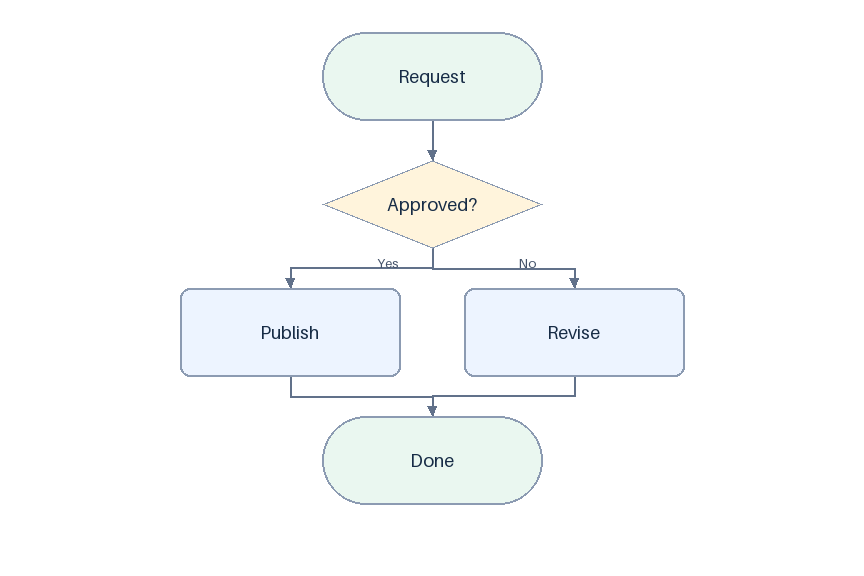

# Diagram2Graph

[](https://github.com/Rk1coder/diagram2graph/actions/workflows/test.yml)

**Turn a flowchart image into editable structure.**

Diagram2Graph reads printed flowcharts with a local vision-language model, validates
the extracted nodes and directed arrows, and produces Mermaid, SVG, PNG and JSON.
Rename nodes in the workbench or edit the graph structure, then regenerate exports
without another model call. User edits preserve the original extraction separately.



The GIF shows actual application states with waiting time compressed. It is not a
latency demonstration. Model measurements are reported separately below.

## Run locally

Linux and Python 3.12 are the verified environment. No inference API key, hosted
rendering service, paid hardware or Node.js runtime is required to run the app.

```bash
python3.12 -m venv .venv
source .venv/bin/activate
python -m pip install -r requirements.txt
python app.py
```

Open **http://127.0.0.1:7865**. Choose an original example or upload a PNG/JPEG, then
select **Extract diagram**. Inspect the graph before using its arrows or labels.
The first extraction downloads and loads the model. CPU inference can take over
a minute; the recorded development run took approximately 92–101 seconds per image.

Use **Node to rename → New label → Rename node** for a quick edit. The advanced
graph editor supports adding/removing nodes or arrows through validated JSON.
Select **Apply graph edits** to update the preview and downloads; they represent
the last applied graph. Download Mermaid to edit the source in a Mermaid-compatible
editor. Layouts can differ across renderers. Edits carry the revision visible when
clicked; a queued edit from an older revision is ignored to protect newer results.

| Variable | Purpose |
| --- | --- |
| `PORT` | Local port, default `7865` |
| `HOST` | Bind address, default `127.0.0.1` |
| `HF_HOME` / `HF_HUB_CACHE` | Model cache location |
| `HF_HUB_OFFLINE=1` | Use already-downloaded model files |
| `D2G_THREADS` | CPU inference threads, 1–16; default 4 |
| `D2G_CACHE_DIR` | Parent for an owned private cache subdirectory |

## Recorded model outputs

Three original development fixtures cover a linear flow, branching, and a retry
loop. In this recorded run, all three match their fixed node labels, shapes and
directed labeled edges. **These are simple development examples, not an independent
benchmark or a general accuracy claim.** The model prompt was designed for this
release's narrow flowchart schema.



[Raw model responses and measurements](evaluation/local-cpu.json) ·
[Evaluation methodology](docs/EVALUATION.md) ·
[Original fixtures and fixed graph annotations](examples/tasks.json)

The model sees only image pixels and a fixed extraction prompt. Ground-truth graphs
are used only by the evaluator. Rendered output files are derived from the recorded
graphs; the reconstructed layout is not intended to reproduce the source geometry.

## Pipeline

```text
PNG / JPEG → image validation → local Qwen3-VL → strict graph JSON
                                                ↓
                                 editable graph + local rendering
                                                ↓
                                      Mermaid / SVG / PNG / JSON
```

- Pinned `Qwen/Qwen3-VL-2B-Instruct` revision
  `89644892e4d85e24eaac8bacfd4f463576704203`.
- Built-in Transformers implementation, `trust_remote_code=False`, weights-only
  loading, CPU float32, greedy decoding, lazy model loading and serialized inference.
- Strict bounded schema; duplicate JSON keys, dangling edges, unknown fields and
  duplicate directed labeled edges are rejected. Model output is never executed.
- Deterministic local rendering handles disconnected nodes, decisions, cycles and
  shortcuts and distinct parallel labeled arrows. Text is escaped for each export format. No external renderer is called.
- Reports retain source hashes, model revision, prompt hash, raw output, settings,
  inference time, original model graph, current graph and parent edit revision.

## Supported scope and limits

- Printed English flowcharts: process rectangles, decision diamonds and start/end
  terminators; up to **12 nodes and 20 arrows**.
- One non-animated PNG/JPEG, up to **10 MiB**, **12 million pixels**, and **4096 px**
  per edge. EXIF orientation is normalized and transparency is composited over white.
- Model image budget: 65,536–262,144 pixels; maximum 768 generated tokens. Tiny text,
  crowded crossings, low contrast or complex arrow routing can be misread.
- Handwritten diagrams, UML/ER/sequence diagrams and original-position fidelity are
  outside the verified scope. There is no reliable missing-diagram detection or
  confidence score; a plausible valid graph can still be wrong.
- SVG and PNG share graph structure but fonts can differ. SVG preserves text as
  editable vector labels; PNG uses Pillow's bundled font and may lack some glyphs.
- Files stay on the machine running the app. Hugging Face is contacted for model
  downloads. Original reports are capped at 24 and expire after one hour. The private
  Gradio cache is independently cleaned at startup and every minute, including after
  a process restart. Cleanup is restricted to a marked `.diagram2graph-owned` child
  of the configured cache parent; sibling files and parent permissions are preserved.
  Immutable public examples bypass expiration.

## Development

```bash
python -m pip install -r requirements-dev.txt
python -m pytest -q
ruff check .
ruff format --check .
python scripts/evaluate.py --output artifacts/evaluation.json
```

The deterministic suite tests validation, safe exports, shortcut routing, graph
metrics, edit provenance, file lifecycle and stale-result handling. Real model
extraction is recorded separately and is not downloaded or run by CI.

Optional Mermaid syntax verification uses Node.js 22 and the official parser:

```bash
npm ci --ignore-scripts
npm run test:mermaid
```

`scripts/make_examples.py` deliberately regenerates the original fixtures and
checksums. Treat changes as a new evaluation dataset version. The recorded run
contains its original prompt and source hashes.

## License and references

Application code: [MIT](LICENSE). Original fixtures: [CC0-1.0](examples/LICENSE).
Model weights: [Qwen3-VL model card and Apache-2.0 license](https://huggingface.co/Qwen/Qwen3-VL-2B-Instruct).
Mermaid is used only for optional export verification and retains its own license.
This project uses a pretrained model; it does not train or claim authorship of it.

- [Mermaid flowchart syntax](https://mermaid.js.org/syntax/flowchart.html)
- [Qwen3-VL source and research](https://github.com/QwenLM/Qwen3-VL)
